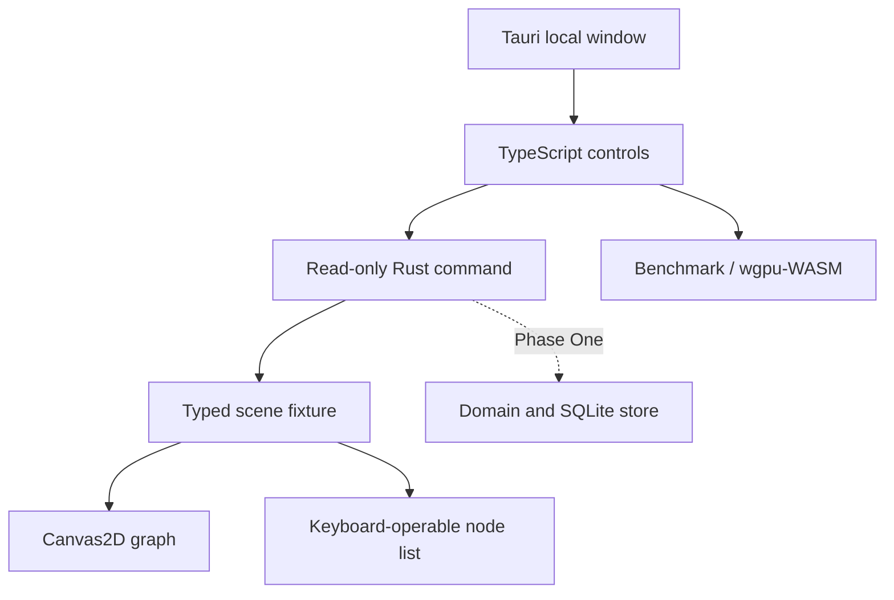

# Phase Zero architecture baseline

**Status:** Phase Zero implementation baseline. Target platform observations are recorded in the [verification log](../Phase-0-Verification.md).

## Native shell and rendering

**ADR-002.** Tauri 2 embeds a local Vite-built web app. Use an accessible HTML node list and Canvas2D graph in a shared view so users can inspect and select nodes with or without an accelerated renderer. The shell probes browser WebGPU for diagnostics. The Northbridge scene uses Canvas2D. The renderer benchmark adds a Rust/wgpu WASM adapter for node and edge geometry, with Canvas2D labels and the existing inspector. A device-loss notification switches the same view to Canvas2D and enables a retry. The benchmark uses generated public fixture data. Any production graph still needs a Rust-authorized scene DTO. Physical Windows WebView2 rendered on an RTX 2060 and recovered from forced device loss. The verification log records the test and frame intervals.

**ADR-011.** Start with vanilla TypeScript and semantic HTML. The platform slice has one view and a local fixture, so the additional UI framework dependency has no present use. Revisit this choice when studio workflows need a shared component lifecycle.

The Rust 2024 workspace starts with `apps/desktop/src-tauri`. The Vite shell and browser smoke tests live in `apps/desktop`. The Phase One store belongs in `crates/atlas-store` behind the app facade. Reusable query and renderer crates should appear with working consumers. The current command returns a typed, read-only diagnostic scene. The scene fixture carries no private data or mutation capability.

## Desktop startup invariants

For direct Cargo builds, `custom-protocol` is a default feature so the WebView loads the built frontend rather than a development localhost server. During `npm run tauri dev`, the Tauri CLI runs Vite and uses `http://127.0.0.1:1420` instead. Both URLs, the CSP WebSocket origin and Vite's strict port are checked together in a Node test. Windows CI tests the default Cargo build's embedded WebView so missing assets or a silent dependency on a live Vite process cannot go unnoticed.

## Contracts for later phases

- **ADR-001, history.** Keep fictional day, author revision and branch independent. Use half-open exact intervals and preserve uncertainty. A fork pins the inherited author revision so later parent edits require deliberate reconciliation. Settle the exact inheritance cut and edge cases against the Phase One branch fixtures.
- **ADR-005, authorization.** Native capabilities come from the trusted app host. Restrict Phase Zero to a single local window and a read-only scene command. The smoke report command accepts observations only when the native executable is launched with the smoke flag. For world data, resolve world/branch/time and audience capability in Rust before producing rows, scenes, counts or caches. Public reads need a narrower capability and explicit publication policy.
- **ADR-006, storage.** Use bundled SQLite so desktop builds carry a known engine. Open with foreign keys enabled, use typed schema and world-scoped references, and wrap a versioned migration in a transaction. Phase One owns the migration, engine version and tested backup behavior.
- **ADR-007, custom types.** Store stable typed identities in a shared registry. User-defined categories and labels can extend governed metadata on known kinds. A new authoritative payload or endpoint kind requires explicit Rust and storage validation.

See the original [architecture](../02-System-Architecture.md) and [decision register](../12-Decisions-and-Reconciliation.md).
